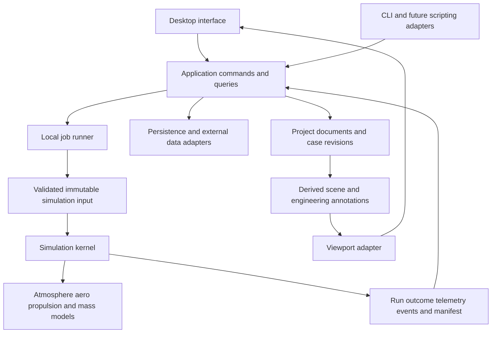

# Aether architecture and roadmap review

**Date:** 18 October 2026

**Scope:** Current working tree, including the UI improvements, against the master plan, phase plans, ADRs, and publicly documented competing tools.

**Status:** Proposed direction for gradual development. Findings below record the initial inspection. Implemented follow-ups are tracked in the [development status](development-status.md); existing plans and ADRs remain unchanged.

## Overall assessment

Aether has a useful technical foundation: a Rust workspace, physics separated from the interface, dimensional newtypes, stable component identity, and automated checks. Keep those investments. The application around that foundation is still an early engineering prototype.

The most important change is the development sequence. The roadmap spends substantial effort expanding physics while deferring basic editing, analysis, and credibility workflows. Undo/redo appears in Phase 6; substantial validation hardening appears in Phase 7. Those capabilities need to develop alongside the first usable product. A sophisticated simulation is difficult to trust when its configuration cannot be saved, its assumptions are unclear, or its result disappears when the model is edited.

The product direction is a **professional workbench for rocket vehicle modeling, flight dynamics, and performance analysis**, serving aerospace engineers and R&D teams. University and experimental teams may also use it, but hobby-software feature parity should not determine the architecture or roadmap. Start with a narrow, explicitly supported vehicle class and flight regime while applying professional standards to configuration, automation, analysis, and evidence from the beginning.

A useful first promise is: **an engineer can establish a vehicle baseline, evaluate changes across defined flight cases, compare results against engineering criteria, and give a reviewer everything needed to reproduce the study.** That promise should guide the interface, data model, and release gates. OpenRocket remains a reference for basic component-editing usability and selected cross-checks; it is not the ultimate product target.

Competitor capabilities below come from official documentation, source repositories, and vendor material. They are documented capabilities, not results of hands-on trials or comparative accuracy benchmarks. Architectural recommendations and workflow judgments are this review's assessment.

## Lessons from existing software

### Market comparison

| Tool | Position and distribution | Relevant documented capabilities | Implication for Aether |
|---|---|---|---|
| **OpenRocket** | Open-source desktop design and flight simulation for model rocketry | Component modeling, 6-DOF, staging/clustering, optimization, plots, and exchanges with other simulators. [Features](https://openrocket.info/features.html) | Use it as a reference for component-editing usability and selected cross-checks. Professional analysis workflows set Aether’s product direction. |
| **RockSim and RockSim Pro** | Commercial desktop products spanning hobby design and more advanced simulation | RockSim Pro documents 6-DOF; its feature material includes component mass in the tree, measurements on drawings, manufacturing aids, and motor search. [Pro product](https://www.apogeerockets.com/index.php?cPath=13_205&main_page=product_software_info&products_id=726), [feature details](https://www.apogeerockets.com/RockSim-Pro-v4-Features) | Small, practical engineering tasks deserve as much attention as rendering and flight animation. |
| **RASAero II** | Freely downloadable desktop aerodynamic analysis and flight simulation; distinguish this distribution model from open-source licensing | Covers model through sounding rockets and supplies aerodynamic predictions for other flight simulators. The project publishes flight comparisons. [Overview](https://rasaero.com/home.htm), [download](https://www.rasaero.com/dl_software_ii.htm), [MESOS comparison](https://www.rasaero.com/dloads/RASAero%20II%20Comparison%20with%20MESOS%20293K%20Flight%20Data%20-%20Rev%20B.pdf) | Make aerodynamic models inspectable, exportable, and supported by case-specific evidence. |
| **RocketPy** | Open-source Python analysis environment used for high-power and research workflows | Its introductory workflow separates environment, motor, rocket, and flight. Its Monte Carlo interface records inputs, outputs, and errors; examples compare simulations with measured flights. [First simulation](https://docs.rocketpy.org/en/latest/user/first_simulation.html), [Monte Carlo](https://docs.rocketpy.org/en/latest/reference/classes/monte_carlo/monte_carlo.html), [flight comparison](https://docs.rocketpy.org/en/latest/examples/bella_lui_flight_sim.html) | Aether needs reusable cases, explicit data inputs, a working automation interface, and retained run records. |
| **ASTOS** | Commercial space and launch-vehicle analysis suite | Trajectory and multidisciplinary optimization, rigid/flexible multibody dynamics, closed-loop simulation, batch processing, and external interfaces. Its project organization separates models, inputs, results, plots, reports, and logs. [Product](https://www.astos.de/products/astos), [project and batch documentation](https://www.astos.de/faq) | Study organization and repeatable analysis chains are valuable professional patterns. Recreating this entire capability set is not a sensible initial scope. |
| **Ansys STK** | Commercial mission and systems analysis environment | Scenarios connect models, time-dependent analysis, reports, and visualization. External ephemerides can define vehicle trajectories, with explicit reference-frame metadata. [Product](https://ansys.synopsys.com/products/missions/ansys-stk), [ephemeris interface](https://help.agi.com/stk/12.10.0/Content/stk/importfiles-02.htm) | Treat a result as reusable engineering data. A future STK export is more realistic than building a competing mission environment. |
| **MATLAB/Simulink Aerospace Blockset** | Commercial modeling environment for flight dynamics and controls | Environment and vehicle models, coordinate transforms, GNC development, software integration, and hardware-in-the-loop testing. [Product](https://www.mathworks.com/products/aerospace-blockset.html) | If controls become important, introduce a clear plant/controller interface and explicit frames. Keep real-time HIL outside the initial product. |
| **OpenMDAO and Dymos** | Open-source multidisciplinary analysis and optimal-control framework | Dymos models ODE systems, organizes phases into trajectories, and supports explicit simulation to check an optimized trajectory. [Introduction](https://openmdao.org/dymos/docs/latest/getting_started/intro_to_dymos/intro_ivp.html), [trajectories](https://openmdao.org/dymos/docs/1.9.0/features/trajectories/trajectories.html) | Geometry search and trajectory/control optimization are different problems. Aether should define which one it supports before selecting an optimizer. |

These tools occupy different categories. STK supplies mission context; Aerospace Blockset supplies a modeling environment; Dymos supplies optimal-control machinery. They are useful architectural references, rather than direct substitutes for a rocket design editor. Detailed propulsion design, CFD, structural analysis, and manufacturing CAD should likewise remain separate disciplines connected through data interfaces.

### The role of the comparison tools

The master plan's emphasis on moving beyond an old-looking Java application understates the actual baseline. OpenRocket already documents six-degree-of-freedom dynamics, optimization, configurable plots, component analysis, and simulation listeners. Its current advanced documentation also describes embedded aerodynamic lookup tables. Aether needs a concrete workflow or evidence advantage beyond those features. [OpenRocket features](https://openrocket.info/features.html), [advanced simulation documentation](https://openrocket.readthedocs.io/en/latest/user_guide/advanced_flight_simulation.html).

ADR-0001 also describes OpenRocket as mixing physics and UI in one implementation. Its current repository has distinct `core` and `swing` modules and lists scripting/integration projects. That does not establish how easily a particular released version can be embedded, but it does invalidate using a blanket lack of separation as the architectural justification for Aether. Keep the Rust/library-first choice on its own merits. [OpenRocket repository](https://github.com/openrocket/openrocket).

The stronger strategic references are ASTOS for vehicle and study organization, Aerospace Blockset for dynamics and controls interfaces, and OpenMDAO/Dymos for structured optimization problems. STK provides a reference for mission context and exchange of trajectory data. Their complete feature sets are long-term context; the first Aether release should solve one professional analysis workflow well.

My preferred differentiation is an **accessible professional rocket-analysis workbench with reproducible studies, understandable model assumptions, and evidence attached to results**. This is a product hypothesis to test with engineers, not an established gap across every competitor.

## Professional product direction

The initial proposed focus is vehicle performance and flight dynamics for aerospace/R&D teams. Guidance and control development and launch-mission optimization are credible later directions, but they create different requirements and should not all be treated as the first release.

| Professional workflow | Aether’s role | Principal reference |
|---|---|---|
| Vehicle performance and flight dynamics | Configure a vehicle, attach analysis models and measured properties, define flight cases, run studies, compare outcomes, and inspect evidence. | ASTOS-style vehicle and study organization. |
| Guidance navigation and control development | Supply a testable vehicle/environment model with explicit controller, actuator, sensor, timing, and event interfaces. | Aerospace Blockset-style closed-loop modeling. |
| Launch mission and trajectory optimization | Express phases, controls, objectives, constraints, and appropriate environment/coordinate models; independently propagate candidate solutions. | ASTOS and Dymos-style trajectory analysis. |

These are proposed product boundaries drawn from the documented capabilities in the market comparison. Selecting a first workflow defines the entry point into the professional category; it does not limit the long-term ambition.

### A first professional analysis workflow

A representative acceptance exercise should be: an engineer imports a vehicle’s measured mass properties and an aerodynamic dataset, defines a nominal flight case and two variations, runs the cases, checks selected engineering limits, compares them with a frozen baseline, and exports a reproducible review package. A second engineer can inspect the input sources and reproduce the reported metrics using the supported release.

That workflow changes what belongs in the first product. The following capabilities become foundational:

- **Analysis models independent of visual detail.** A vehicle can use measured mass, CG, and inertia, and an imported aerodynamic model. A detailed component drawing must not be a prerequisite for using higher-quality engineering data.
- **Explicit model contracts.** Coefficient datasets identify axes, signs, moment reference, reference area/length, units, independent variables, interpolation/extrapolation rules, source, and validity range. Mass-property interfaces should identify the reference frame and support a CG vector and inertia tensor; an initial axisymmetric solver can validate and use a restricted subset. An attractive mesh cannot resolve ambiguity in these definitions.
- **Versioned configurations.** Vehicle variants, model datasets, installed propulsion, environment, events, and numerical options resolve into a complete run input. Reviewing a baseline must not depend on someone’s current UI settings.
- **Engineering quantities and criteria.** Define named outputs and checks, such as peak dynamic pressure or a required margin over a specified phase. A review should show the criterion, evaluated result, assumptions, and relevant diagnostics together.
- **Automation and exchange.** Provide stable structured files and a headless execution interface early, followed by a convenient Python-facing workflow. Keep the GUI and automation on the same validated execution path.
- **Evidence and traceability.** Store source data, overrides, model versions, comparison history, and verification/validation coverage with the study. Preserve incomplete and failed runs as explicit outcomes.

Start with built-in model implementations and documented interfaces. Full native plugin loading, distributed jobs, and a general graphical modeling language are separate investments that require demonstrated demand.

### Consequences for the interface and development order

The top-level object is an engineering project containing vehicle configurations, model datasets, cases, studies, results, and evidence. The component editor is one view inside that project. A study table, parameter editor, dataset inspector, plot workspace, event timeline, and review report deserve first-class space alongside geometry inspection.

For the first supported scope, a rigid single-body vehicle can be sufficient. Professional quality comes from a correct, explicit model and a dependable analysis workflow within that scope. Multistage dynamics, flexible bodies, real-time HIL, and mission optimization can then expand the supported scope through separate evidence gates.

Retain simple model rockets as fast regression fixtures. Add a separate professional demonstration project with measured property overrides, a documented coefficient dataset, multiple named cases, a baseline comparison, and a review report. The size of a test rocket should not define the intended customer or the product’s ceiling.

## What the repository actually supports

The current workspace test run completed with **231 passing tests and 19 ignored tests**. That is a useful regression baseline. It does not establish the accuracy percentages in the phase plans.

| Area | Implemented evidence | Readiness assessment |
|---|---|---|
| Core separation | Separate core, aero, physics, simulation, I/O, render, UI, and CLI crates; dependency check | A sound foundation to retain. |
| Model editing | Parametric components, selection, inspector, 3D visualization, default design | A usable prototype; document transactions and complete assembly semantics are missing. |
| Data integrity | JSON serialization and a schema version field | No schema-version dispatch, explicit migrations, central semantic validation, or atomic-save workflow is implemented. |
| Cases and studies | Launch/recovery settings held in `SimPanelState` | Saving the rocket does not save those settings, the motor choice, or a reproducible study. |
| Simulation | 3-DOF and quaternion-based 6-DOF implementations | Working code with significant approximations and consistency issues; accuracy gates remain unproven. |
| Adaptive integration and atmosphere | DOPRI5 and US-1976 implementations exist | The current 6-DOF flight loop calls RK4 and constructs `IsaAtmosphere`. Presence of a module is not end-to-end integration. |
| Results | Summary metrics and basic telemetry/plots | No immutable run record, solver manifest, event history, or persisted comparison workflow. Telemetry lacks attitude for genuine 6-DOF playback. |
| Automation | CLI motor operations and status command | The CLI does not yet expose flight simulation. Library reuse is ahead of the user-facing automation path. |
| Uncertainty and optimization | Workspace crates and descriptive module comments | The Monte Carlo and optimizer crates are scaffolding, not implemented capabilities. |
| Validation and delivery | Unit/integration tests; Linux CI | Independent datasets are incomplete, and desktop/GPU acceptance is not covered across the target operating systems. |

Evidence: [model](../crates/rocket-core/src/rocket.rs), [persistence](../crates/rocket-io/src/lib.rs), [UI state and execution](../crates/rocket-ui/src/simulate.rs), [flight loop](../crates/rocket-sim/src/state6dof.rs), [telemetry](../crates/rocket-sim/src/result.rs), [CLI](../crates/rocket-cli/src/main.rs), [Monte Carlo](../crates/rocket-monte-carlo/src/lib.rs), [optimizer](../crates/rocket-optimizer/src/lib.rs), [CI](../.github/workflows/ci.yml).

### Numerical findings that should block wider fidelity claims

These findings are based on the expressions and call paths in the source. Each needs a focused regression and correction before using more elaborate trajectories as evidence of accuracy.

| Priority | Finding and source | Engineering consequence |
|---|---|---|
| High | Nose mass uses a solid conical approximation regardless of nose shape or wall thickness. Fin CG is approximated from quarter-MAC, and roll inertia uses `mass * max(0.05, thickness²/12)`. [Mass model](../crates/rocket-core/src/rocket.rs), `component_mass_properties` | Geometry edits can disagree with mass readouts; inertias are not reliable enough to justify detailed rotational predictions. Introduce validated geometry-specific mass properties and measured overrides. |
| High | Motor CG is approximated as dry-rocket CG plus half motor length, rather than using its physical mounting position. [Flight mass properties](../crates/rocket-sim/src/state6dof.rs), `mass_properties_at` | Motor placement does not consistently affect loaded CG and inertia. Define an actual installed motor assembly before expanding propulsion/staging. |
| High | Aerodynamic moments use dry-rocket CG inside `compute`, while the simulator separately calculates time-dependent CG and then does not use it to correct those moments. [Aero computation](../crates/rocket-aero/src/buildup.rs), [dynamics](../crates/rocket-sim/src/state6dof.rs) | Burning propellant does not consistently change the aerodynamic moment reference. The coefficient contract must state where moments are referenced. |
| High | Recovery force multiplies `q_bar * cd_a` by an additional factor of two even though `q_bar` already equals `½ρV²`. Telemetry force evaluation reads `self.recovery`, while integration uses the evolving local recovery state. [Recovery dynamics](../crates/rocket-sim/src/state6dof.rs) | Descent predictions and reported forces need correction and a shared dynamics evaluation path. Test force magnitude and event state directly. |
| High | Roll and pitch damping coefficients include angular rate times reference length divided by two, without the airspeed normalization described in their comments. [Damping calculation](../crates/rocket-aero/src/buildup.rs), `compute` | The rate normalization is dimensionally inconsistent. Specify nondimensional rates and verify damping over a speed sweep. |
| High | The flight loop uses ISA, whose altitude query clamps at 11 km. US-1976 exists separately. [ISA](../crates/rocket-physics/src/atmosphere.rs), [simulator construction](../crates/rocket-sim/src/state6dof.rs) | An apparently successful high-altitude run can silently use an inappropriate atmospheric state. Select models explicitly and report domain violations. |
| Medium | The loop stops at 300 seconds but returns a normal `SimResult` with `landing_time`; invalid timing configuration returns an empty result. [Run termination](../crates/rocket-sim/src/state6dof.rs), [result](../crates/rocket-sim/src/result.rs) | The user cannot reliably distinguish landed, timed out, invalid, and failed runs. These need explicit outcomes. |

The solver also needs an explicit pad/rail/free-flight lifecycle and tests for delayed thrust, failure to lift off, and rail exit. Existing frame comments disagree about quaternion direction in places, while geometric position is measured aft from the nose and the dynamics body axis points toward the nose. These conventions can coexist, but the transforms must be specified and tested centrally.

### The validation gap

The Phase 3 plan asks for CP agreement within 0.5 calibers, Cd agreement within 10%, and measured HPR apogee agreement within 7%. Current tests such as `cd_at_mach_0_1_in_expected_range` accept Cd between 0.3 and 1.0. The test named `recovery_descent_rate_matches_terminal_velocity` checks a broad 0.1–20 m/s range rather than the specified analytical tolerance. They are useful plausibility checks, but they do not demonstrate those accuracy gates. [Phase 3 tests](../crates/aether-tests/src/phase3_validation.rs), [Phase 3 plan](../rocket-simulator-phase3-plan.md).

The RASAero reference CSV is still a TODO, and the Barrowman fixture contains untranscribed fin and total values. Some important integration tests remain ignored; related checks also exist in unit modules, so consolidate their coverage rather than assuming every ignored name means a completely untested feature. [RASAero fixture status](../tests/fixtures/reference_data/estes_alpha_rasaero.csv.md), [Barrowman fixture](../tests/fixtures/reference_data/sp7224_worked_example.json), [aero tests](../crates/aether-tests/src/aero.rs), [dynamics tests](../crates/aether-tests/src/dynamics.rs).

## Architecture to retain and strengthen

### Keep the modular Rust implementation

Retain the workspace, headless numerical libraries, SI storage, local operation, and stable component references. A modular desktop application with worker threads is sufficient for the next stages. There is no present requirement for a service architecture, cloud accounts, distributed execution, or a plugin marketplace.

The missing boundary is an **application layer** between interface events and engineering data. Begin as a module, extracting a `rocket-app` crate when the GUI and CLI both use it. It should own editing commands, document lifecycle, case preparation, job submission, and result registration. It should not contain widgets or aerodynamic formulas.

The arrows describe data and control flow, not a rule that numerical crates depend on project management or presentation. The kernel should accept plain validated inputs and return plain outcomes; it must remain callable without an application session.

### Introduce project case and run objects

The rocket model is only one input to an engineering study. Add the following concepts incrementally rather than placing more transient state in `AetherApp`.

| Object | Responsibility |
|---|---|
| **Project** | Named designs, cases, input assets, run references, and review notes. |
| **DesignRevision** | A version of component geometry, materials, mass overrides, and installation references. |
| **SimulationCase** | A selected design revision plus installed motor data, environment, launch configuration, recovery/events, numerical settings, and model choices. |
| **PreparedSimulation** | Resolved, validated, immutable input used by the kernel; no filesystem/network lookup during a run. |
| **RunRecord** | Exact input snapshot, model/solver versions, input digests, termination status, diagnostics, events, telemetry, and summary metrics. |
| **Study** | A collection of cases/runs with a comparison or parameter-sweep purpose; can start as a simple named collection. |

A case should distinguish a reference to the current design from the frozen design snapshot used by an existing run. Editing a design should mark affected cases as changed while preserving historical results. The current `mark_dirty` clears the last result, while changing motor or launch settings can leave the old result displayed without an input-change status. Both behaviors prevent dependable A/B analysis. Track all case inputs and retain the result with its original snapshot. [Design invalidation](../crates/rocket-ui/src/app.rs), [case settings and results](../crates/rocket-ui/src/simulate.rs).

Record actual motor/weather/coefficient data or resolvable content digests alongside provenance. A motor designation or weather-service URL alone is insufficient to reproduce a run after upstream data changes. Include solver tolerances, sampling policy, application/kernel build, and random algorithm/seed when relevant. Define reproducibility through documented numerical tolerances across platforms; do not promise universal bit identity merely because inputs are fixed.

### Make editing transactional

Use commands such as add, remove, modify, reorder, and change-installation. A command validates references, applies one undoable edit, increments the relevant revision, and reports diagnostics. A drag gesture should become one undo step rather than hundreds of individual edits.

This is immediately useful for undo, redo, dirty state, change summaries, and testing. ADR-0008 already envisages an `Edit` representation but treats it as future collaboration preparation. Make it an active part of the local editing architecture. Selection, camera position, and panel state should remain view state, outside undoable engineering changes. [ADR-0008](adr/0008-local-only-files-v1.md).

### Validate before simulation and protect documents

Add one semantic validation path used by GUI, CLI, and file import. Check finite values, physically permitted dimensions, material references, unique IDs, attachment compatibility, installed motors, and supported component/stage combinations. A file containing an unsupported upper stage must not be accepted as an apparently complete simulation when mass/aero traversal only covers the root stage.

Separate incomplete editable designs from runnable cases. A partially constructed rocket can be saved; a case with unresolved mandatory inputs cannot run. Diagnostics should identify the component or field, explain the consequence, and provide a useful action.

Implement schema-version dispatch and explicit migrations, atomic replacement of saved files, recovery copies, unsaved-change handling, and external-file-change detection. Today `load_from_json` directly deserializes and saving writes directly to the destination. Keep the existing `.rocket` design import while introducing project/case storage compatibly. [Loader](../crates/rocket-io/src/lib.rs), [save implementation](../crates/rocket-ui/src/app.rs).

Start with an inspectable project directory and small JSON manifests. Keep large telemetry separate from the design; introduce a columnar format when measured dataset size warrants it. A portable archive can be an export of that structure. Define canonical ordering for digests and diffs: a hash-map-backed material library does not by itself guarantee stable textual ordering. Decide explicitly between readable JSON and compressed transport; compressed JSON is not directly diff-friendly.

### Separate jobs from widgets

The GUI currently runs `Simulator6Dof::run` synchronously and clones the complete result for display. Move execution to a local worker with job ID, immutable input, progress, cancellation, and a final outcome. Retain telemetry by shared ownership or bounded chunks, and draw reduced plot data when necessary. [Current execution and display](../crates/rocket-ui/src/simulate.rs).

Use the same preparation and execution path for a CLI command such as `aether simulate case.json`. A GUI run and a CLI run of the same prepared case should agree within the declared tolerance. Resolve external data before execution, so network availability cannot change an analysis halfway through.

Monte Carlo should later reuse this job path, assign random streams by sample index, and retain failed/cancelled sample counts. A percentile derived only from successful runs can be misleading if failures are silently discarded.

## The engineering workflow the interface should support

The application should let the user answer four questions consistently: **what am I modeling, under which conditions, what happened, and why should I trust the answer?**

Use four stable workspaces: **Model, Cases, Results, and Evidence**. Keep the current three-panel arrangement where it helps modeling, but do not force every task into an inspector next to a permanent 3D scene.

| Workspace | Primary content | Necessary behavior |
|---|---|---|
| **Model** | Assembly tree, engineering side view, selected component inspector | Named components; physical attachments; dimensions and units; undo; measured mass/CG overrides; internal visibility; dry versus loaded mass. |
| **Cases** | Table of named motor/environment/recovery configurations and readiness states | Duplicate a case, change one input, see validation issues, submit jobs, cancel without losing results. |
| **Results** | Run table, metric comparison, linked plots, events, optional playback | Overlay runs, show units and deltas, distinguish stale/failed/incomplete runs, export the displayed analysis. |
| **Evidence** | Model assumptions, supported range, input sources, verification/validation references | Explain which methods produced a result and which evidence covers its operating conditions. |

Prioritize a dimensioned **2D side view** alongside 3D inspection. Axial placement, diameters, fin offsets, CG, and CP are engineering relationships that must be easy to compare. Add scale, station markers, named selections, and overlays; reserve 3D for shape, assembly inspection, and playback. This is a workflow recommendation, not a request to build manufacturing CAD.

A polished interaction system also needs consistent numeric entry, display-unit preferences, tab order, visible focus, keyboard actions, field help, and readable contrast at different scales. Represent warnings with text and an action as well as color. Distinguish document state, case readiness, and job status; “saved” says nothing about whether a simulation is current or valid.

Do not make unrestricted docking the first usability project. Establish good default layouts and task flows first. Demonstrate them with a small reference project containing two cases and retained results, so testing exercises comparison rather than only first-run rendering.

Suggested initial usability exercises are: place a fin at the intended body station; enter a dimension with a keyboard; inspect an internal mass; undo a deletion; compare two motors; diagnose a non-runnable case; and reopen a study on another machine. Observe a few intended users completing these tasks before enlarging the feature set.

## The UI framework decision

**Keep egui provisionally and evaluate it against a concrete workflow.** Changing frameworks before defining that workflow risks reproducing the same application design elsewhere. The egui project documents custom widgets, accessibility integration, and examples of professional applications, while also describing layout limitations and API changes. Aether must budget for its own component system, integration tests, and upgrade work. [egui documentation](https://raw.githubusercontent.com/emilk/egui/master/README.md).

Revisit ADR-0002's reasoning. Its assertion that a Tauri front end would sacrifice native Monte Carlo threading is not a necessary consequence of that architecture: Tauri separates WebViews from a Rust core process. Native simulation work can remain in Rust. The actual tradeoffs include IPC/data transfer, renderer integration, platform WebView behavior, and maintaining a second UI toolchain. [Tauri process model](https://v2.tauri.app/concept/process-model/).

| Choice | Recommendation |
|---|---|
| **egui with an application layer and reusable controls** | Current default. Build one complete model → two cases → comparison workflow and assess input, layout, accessibility, and plotting. |
| **Qt-based desktop front end** | Candidate if mature desktop interaction becomes difficult to deliver economically. Its model/view facilities are relevant to trees and tables; account for integration and deployment costs. [Qt model/view documentation](https://doc.qt.io/qt-6/model-view-programming.html) |
| **Web interface with a Rust desktop backend** | Candidate if a larger design system, rich data views, or UI-development staffing makes it attractive. Prototype the viewport and large-result transfer before committing. |

Evaluate keyboard-only completion, IME/text editing, display scaling, accessibility, persisted layout, large trees/tables, and responsive analysis. A proposed acceptance target is no input stalls attributable to simulation work and ordinary editing feedback within 100 ms on an agreed reference machine. Measure; do not substitute a screenshot for this assessment.

Keep raw wgpu for now, but separate scene description and selection semantics from the eframe callback. Explicitly distinguish analysis geometry, rendered surfaces, and selection proxies. The cube representing a point mass should be recognizable as a visualization, not an implied physical solid. A rendering engine change should not alter mass properties or aerodynamic reference geometry.

## Numerical credibility and reference projects

Verification asks whether the implementation solves its stated equations correctly. Validation asks whether those equations and inputs adequately represent the intended physical system. Cross-tool agreement is useful evidence, but shared assumptions can make two tools agree for the wrong reason. NASA's modeling-and-simulation guidance is a useful framework for defining intended use, acceptance criteria, and credibility evidence; adopting selected practices does not establish NASA acceptance of Aether. [NASA-STD-7009](https://standards.nasa.gov/standard/NASA/NASA-STD-7009), [implementation handbook](https://standards.nasa.gov/standard/NASA/NASA-HDBK-7009).

Build three separate case collections:

1. **Demonstration projects:** simple, editable examples such as Aether One. They test usability and integration.
2. **Verification cases:** analytical trajectories, geometry/mass integrals, frame transformations, event timing, convergence, and symmetry. Their expected answers must be independent of the implementation.
3. **Validation cases:** measured flights and controlled comparisons with fully specified geometry, motor curves, environments, model settings, source versions, and accepted tolerances.

For every validation case, record input uncertainty, source/page/table, data processing, metric definitions, and whether parameters were calibrated using that same flight. Keep calibration cases separate from withheld evaluation cases. The RASAero MESOS comparison explicitly discusses a postflight surface-finish adjustment; that is a useful example of why preflight prediction and postflight reconstruction must remain distinguishable. [MESOS analysis](https://www.rasaero.com/dloads/RASAero%20II%20Comparison%20with%20MESOS%20293K%20Flight%20Data%20-%20Rev%20B.pdf).

RocketPy's Bella Lui example demonstrates an accessible pattern: configured vehicle and environment data followed by measured-versus-simulated altitude and velocity plots. Aether should publish similarly inspectable cases, with suitability and redistribution permissions checked before reusing datasets. [Bella Lui example](https://docs.rocketpy.org/en/latest/examples/bella_lui_flight_sim.html).

Define model validity using relevant conditions such as Mach, Reynolds number, angle of attack, geometry class, and atmosphere range. T0/T1/T2 may remain useful presets, but they should resolve into explicit model choices and report any unsupported combinations. “Higher fidelity” must identify what changed and what evidence supports it.

Use an error budget to prioritize additional physics. Correct installed mass, motor placement, recovery, and aerodynamic assumptions before adding small environment corrections. Introduce advanced atmosphere or gravity models when sensitivity studies show that they matter within the next supported regime, with appropriate reference data available.

Return structured outcomes such as landed, no liftoff, cancelled, time limit, invalid input, numerical failure, and unsupported regime. Preserve diagnostic context. Store local Mach, attitude, angular rates, relevant aero quantities, and actual events when the corresponding analysis claims to use them. A sea-level approximation to peak Mach and telemetry without attitude should not be presented as a complete high-altitude 6-DOF analysis.

For solver work, prioritize one consistent dynamics evaluation, correct variable mass/moment references, event localization, convergence checks, and explicit numerical settings. Integrate DOPRI5 only through this common path, with per-state error scaling and comparisons to converged reference solutions. Adaptive stepping is a numerical method choice, not a product milestone by itself.

## Revisions to the existing plan

Preserve the ambitious long-term direction while correcting these decisions and inconsistencies:

| Existing plan issue | Proposed revision |
|---|---|
| Undo and substantial UI work arrive in Phase 6 | Move reversible editing, document safety, units, and keyboard workflows ahead of broader physics. |
| V&V hardening is a late phase | Require a verification/validation evidence increment with every model increment. Keep plausibility tests, but label them accurately. |
| Phase 2 says to tune Cd to match an apogee target | Separate calibration from evaluation. Document calibration parameters and freeze them before measuring generalization. |
| Fidelity tiers imply a simple progression toward more accurate answers | Publish model contracts and validity ranges; validate each supported combination. |
| Phase 3 describes functionality that exists in isolated modules but is not connected to the production loop | Track four statuses separately: planned, implemented, integrated, and supported by validation evidence. |
| The master diagram conflicts with the stated dependency direction | Replace it with the actual Cargo dependency graph plus a separate runtime data-flow diagram. |
| Detailed aero/dynamics and Monte Carlo specification links point to absent files | Restore reviewed specifications or replace the links with concise maintained contracts. Both referenced files are absent in this checkout. |
| STEP export is described both as in scope and deferred; JSON is described as gzipped and diff-friendly | Decide explicitly. Recommend engineering visualization now, lightweight exports when needed, and manufacturing CAD/STEP later. |
| Performance target specifies 10,000 runs in 60 seconds without a complete benchmark contract | Specify vehicle, flight phases, tolerances, output rate, hardware/cores, sample failures, and warm/cold data. Optimize after correctness. |
| ADRs make categorical claims about competing codebases and frontend performance | Replace them with observed constraints, prototypes, and measured tradeoffs. |

Review formula conventions and source identifiers as part of that cleanup. The master plan has inconsistent scalar-state counting and contains equations whose notation does not match the intended dimensional relationship. The Barrowman fixture should cite an audited report and exact pages/tables, rather than relying on its current unverified `SP-7224` label and incomplete values. NASA provides a copy of Barrowman's original work suitable for checking the bibliography and transcription. [NASA source](https://ntrs.nasa.gov/api/citations/20010047838/downloads/20010047838.pdf).

## A gradual roadmap with evidence gates

These stages replace calendar confidence with demonstrable progress. Advance one coherent workflow at a time; numerical repair and verification should continue through the early product stages.

| Stage | Deliverable | Exit gate |
|---|---|---|
| **0 — Reconcile evidence and supported scope** | Capability inventory, corrected model contracts, targeted solver defects, validation-case manifest, declared initial operating envelope | Every advertised capability maps to an integrated path and an evidence status. Unsupported inputs produce explicit outcomes. Numerical findings above have focused regressions and dispositions. |
| **1 — Reliable engineering documents** | Application command layer, undo/redo, semantic validation, safe save/recovery, compatible schema migration, saved cases | Create/edit/undo/reopen preserves a project and its cases. Interrupted saves preserve the previous file. Invalid references and unsupported versions are explained consistently in GUI and CLI. |
| **2 — Professional vehicle modeling workflow** | Vehicle configurations, named assembly, 2D/3D inspection, units, installation references, measured mass/CG/inertia inputs, coefficient-data inspection, reusable controls | Engineers configure the reference vehicle using explicit model sources and reference conventions; geometry, measured overrides, and analysis annotations remain consistent. Review the framework against measured interaction results. |
| **3 — Reproducible runs and engineering review** | Local workers, cancellation, simulation CLI, immutable run records, named quantities/criteria, baseline comparisons, linked plots, event timeline, review export | A nominal case and variations run without freezing editing; criterion results and comparisons survive reopening; a second engineer reproduces the study; failure and cancellation cannot appear as successful flights. |
| **4 — Professional release within a defined flight regime** | Converged single-body solver, physical mass/propulsion/recovery models, imported-data contracts, independent reference panel, published limitations and validation report | Meet predeclared accuracy criteria on specified cases, without tuning against the evaluation set. Demonstrate that error is acceptable for the intended use. |
| **5 — Studies and uncertainty** | Parameter sweeps first; deterministic sampling, uncertainty inputs, retained failures, sensitivity and dispersion views | Repeatable sample sets, reported failure rates, convergence evidence, and physically meaningful uncertainty summaries. Add optimization only after its objectives and constraints are trusted. |
| **6 — Expand one advanced regime** | Choose one need: staging, a validated transonic/supersonic envelope, or controls integration | Each increment has suitable inputs, explicit events/interfaces, its own validation panel, and reviewable results. Reassess before attempting a general sounding-rocket tier. |
| **7 — Broader organizational use** | Review bundles, baseline comparisons, release/support policy, reproducible installers, required integrations; shared repositories only if demanded | Another team member can reproduce and review a study using a supported release. Add access control, central job services, or institutional integrations only for an identified deployment need. |

Desktop delivery is a cross-cutting requirement: retain quick Linux checks, add Windows/macOS build and launch smoke tests, and exercise renderer/input behavior on representative GPU backends before claiming equivalent support. Add dependency/asset provenance and migration compatibility to release review. These measures support the native desktop promise already in the plan.

## Immediate recommendations

The next three implementation changes should be small enough to review independently:

1. **Evidence inventory and one solver correction:** map existing tests to the promised gates, add a recovery-force/terminal-velocity regression with an analytical tolerance, and correct the recovery force/state path. Track mass, motor placement, and moment-reference fixes as separate follow-ups.
2. **One undoable editing path:** introduce an application module for a body-tube dimension edit, including validation, revision tracking, undo, and redo. Prove the boundary with that operation before migrating every editor action.
3. **Safe persistence for the current document:** add atomic saving and explicit schema-version checking, with failure-path tests preserving the previous file. Keep the current design format usable while planning case persistence.

Then add one saved simulation case, one background job, and one retained run record in separate changes. Use two such runs to build the first comparison view. This sequence exposes architectural mistakes while their correction is still inexpensive.

Keep each proposal narrow enough to review and release independently. Maintain a working reference project through every step. Use that project to demonstrate the whole workflow, while keeping independent validation datasets separate.

The decisions to settle before advanced-model expansion are the first professional workflow and flight envelope, the independently sourced validation panel, and the study bundle needed by a reviewing engineer. Those choices provide a firmer basis for slow, durable progress than adding another solver feature or another visual theme.
