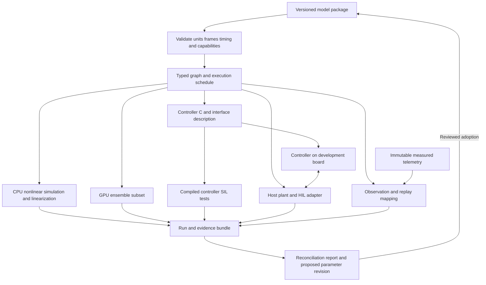

# Aether model to flight execution plan

**Date:** 18 October 2026

**Status:** Adopted product direction; the capabilities below are planned.

**Parent:** [Engineering plan](rocket-simulator-plan.md)

**Decision:** [ADR-0011](docs/adr/0011-shared-model-and-execution-targets.md)

Aether will develop into an open engineering workbench that carries one versioned
vehicle and control-system definition through simulation, generated controller
code, hardware-in-the-loop testing, and flight-data reconciliation. The first
release will demonstrate that loop for one rigid rocket vehicle and one controller,
with automatic linearization and a measured GPU Monte Carlo implementation.

The existing Rust editor, project files, retained runs, CLI, and aerodynamic-data
contracts form the starting point. This plan changes development priorities; it
does not imply that code generation, HIL, GPU ensembles, or measured-flight replay
are already implemented. [Development status](docs/development-status.md) records
implemented behavior and numerical limitations.

## 1. Product focus and competitive position

The initial audience is small-launcher GNC teams and university experimental
vehicle teams that need to reproduce controller tests and explain discrepancies
between simulation and measured behavior. University CubeSat/ADCS teams are an
adjacent pilot audience for the controller, HIL, and replay contracts; orbital
propagation, spacecraft buses, and mission operations are a separate expansion.
Adoption by these groups is a hypothesis to test through pilots.

The opportunity is reducing manual translation and preserving evidence across
engineering tools. A workflow using Simulink, Embedded Coder, Trick, dSPACE, and
custom telemetry processing is a motivating example, rather than a description
of every team's process. Embedded Coder already generates embedded C/C++;
dSPACE already supports FMU import on several platforms. Aether should support
incremental integration with existing tools. [Embedded Coder](https://www.mathworks.com/products/embedded-coder.html),
[dSPACE FMI compatibility](https://www.dspace.com/en/pub/home/support/supvers/supverscompm/fmicompatibility.cfm).

Avoid claiming that no open solution exists. Basilisk documents spacecraft
simulation, repeatable Monte Carlo, HIL, and comparison with flight data. Trick
supports simulation and virtual/hardware testing. OpenModelica exports models
through FMI; SciML provides linearization, C function generation, and GPU ODE
ensembles. The proposed distinction is an accessible, reproducible rocket
workflow tying these stages to the same model and artifact identities.
[Basilisk](https://avslab.github.io/basilisk/), [Trick](https://nasa.github.io/trick/),
[OpenModelica FMI](https://openmodelica.org/doc/OpenModelicaUsersGuide/latest/fmitlm.html),
[ModelingToolkit linearization](https://docs.sciml.ai/ModelingToolkit/stable/basics/Linearization/),
[Symbolics function generation](https://docs.sciml.ai/Symbolics/stable/manual/build_function/),
[DiffEqGPU](https://docs.sciml.ai/DiffEqGPU/stable/).

Pilot acceptance is concrete: a second engineer can regenerate the controller,
repeat a simulation and board test, import a measured log, and explain a model
revision without re-entering vehicle parameters or translating signal meanings.
Record time spent on manual handoffs, integration defects, reproducibility, and
whether the team chooses to repeat the workflow on another study.

## 2. First reference workflow

Use a single-stage, rigid-body, subsonic research rocket with a prescribed thrust
curve, installed motor mass/CG/inertia, and a two-axis TVC actuator model. Define
a sampled attitude/rate controller with saturation and explicit state. Start
with known attitude/rate inputs, then add one specified sensor/estimator chain.
Document roll behavior, actuator limits, atmosphere, aerodynamic validity, and
the accepted operating envelope. Aether One remains the passive UI fixture;
create a separate controlled reference with independently specified answers.

The demonstration proceeds through these linked artifacts:

1. Save the declarative vehicle, plant selection, controller, signal dictionary,
   and test case as one versioned model package.
2. Run the nonlinear CPU plant with the reference controller; linearize a smooth
   operating point and selected points along its nominal trajectory.
3. Generate C from the controller definition, compile it, and repeat the same
   input vectors and closed-loop scenario in software-in-the-loop (SIL).
4. Run the same sampled uncertainty set on CPU and the supported GPU subset;
   retain failures, output differences, and end-to-end timing.
5. Execute the generated controller on one development board against the host
   plant in HIL; record timing, sensor packets, commands, resets, and faults.
6. Replay a measured log through the same observation/controller interfaces,
   compare predicted measurements, and publish an explicit parameter revision
   with its reconciliation report and a separate held-out evaluation.

A synthetic log proves import and replay mechanics. At least one independently
recorded dataset is required for the pilot's reconciliation gate. A runnable
loopback demonstrates the HIL protocol; an actual board run is a separate gate.

## 3. Shared model and compilation boundary

A shared model is a package with distinct plant, controller, and experiment
sections. The simulated physical plant stays on the host during the initial
board test; the controller is the embedded artifact. A parameter-only JSON file
cannot provide portable equations, differentiation, or controller semantics.

| Definition | Required contents |
|---|---|
| Vehicle and plant | Geometry or measured mass properties, installations, explicit equations/model IDs, coefficient datasets, frames, units, validity and source evidence |
| Controller | Typed ports, block/equation graph, discrete state, sample periods, reset order, arithmetic precision, limits and fault behavior |
| Sensors and actuators | Frames/lever arms, specific-force versus acceleration semantics, calibration, noise, quantization, delays, saturation and rate limits |
| Experiment | Initial state, parameter bindings, disturbances, scheduler, event/reset rules, numerical settings, uncertainty distributions and criteria |
| Observation/replay mapping | Signal IDs, units, clock mapping, missing-data policy, calibration versions and mapping from plant truth to expected measurements |
| Build receipt | Model/graph/schema hashes, toolchain and target versions, compile options, precision, ABI/protocol versions and artifact hashes |

Compile this package into a typed intermediate representation (IR): a restricted
operation graph and schedule with source locations. Begin with fixed-size
arithmetic, matrix operations, lookup tables, gains, sums, delays, integrators,
saturation, and explicit state machines. Reject unsupported operations,
instantaneous algebraic loops, units, frame connections, and timing conflicts
with diagnostics tied to the model source. Do not begin with a general acausal
modeling language or a graphical Simulink clone.

The graph must have shared evaluation semantics for CPU execution, automatic
differentiation, C emission, and eligible GPU lowering. Primitive implementations
require independent value/derivative/backend checks. Existing handwritten Rust
physics can be registered as a versioned primitive only with its derivative and
target-support contract; opaque code must not silently acquire AD/GPU support.
Unsupported models remain runnable on the CPU under their declared capabilities.

Proposed module boundaries are `model` (schema/IR), `control` (sampled semantics),
`analysis` (trim/linearization), `codegen` (target emission), `hil` (clock/I/O),
and `replay` (observations/alignment). Establish modules first; extract crates
when dependencies warrant it. They must not depend on the UI or renderer.
`rocket-sim` owns host orchestration; it must call the shared evaluator rather
than grow a second set of controller or plant equations. CFD remains an offline
coefficient producer bound to a vehicle revision, outside every real-time loop.

## 4. Rust and Julia decision

Retain Rust as the production workspace, native UI host, and reference runtime.
Evaluate Julia as an optional analysis/build tool before deciding whether its
symbolic and GPU infrastructure should produce portable artifacts for Rust.
Rewriting the current application or maintaining two independently authored
production physics models is outside this increment.

Timebox a ten-engineering-day spike using one shared, small nonlinear plant and
stateful controller. Compare a restricted Rust graph/AD/emitter approach with a
Julia ModelingToolkit/Symbolics/DiffEqGPU route. If appropriate, compare reuse of
an existing generator such as CasADi rather than implementing a symbolic engine.
These tools expose relevant building blocks; none removes our scheduling,
controller-state, sensor, artifact, or target-validation obligations.
[CasADi documentation](https://web.casadi.org/docs/).

Measure model-authoring duplication, derivative correctness, C semantic parity,
GPU restrictions and precision, packaging, cold-start/build cost, and debugging.
Julia must consume or generate the shared definition with traceable transforms;
a separately maintained notebook model is only a verification oracle. Select
the smallest maintainable route, pin its toolchain, and record the decision and
remaining gaps before implementing the general compiler. Keep Julia optional
at desktop runtime if the selected artifact workflow permits it.

## 5. Automatic linearization

Expose continuous plant dynamics and observations as `xdot = f(t, x, u, p, mode)`
and `y = h(t, x, u, p, mode)`, alongside discrete controller and event/reset maps.
Produce A, B, C, D with state/input/output names, units, operating state, time,
parameters, mode, derivative method, precision, and model hash. Include the
nominal derivative and trim residual so a trajectory snapshot is not mistaken
for an equilibrium. Add trim solving only for explicitly constrained problems.

Represent attitude perturbations with three local rotation coordinates around
the reference quaternion, documenting left/right error convention. The rigid
plant has 13 stored kinematic scalars and 12 local perturbation coordinates;
actuator/estimator states extend that system. Mass is initially derived from
the installed propulsion schedule. Do not linearize four unconstrained
quaternion components and present the redundant mode as physical.

Use automatic differentiation on supported smooth operations, checked against
analytical fixtures and finite-difference step sweeps. Lookup boundaries,
saturation, mode changes, burnout, and recovery deployment need explicit
one-sided or mode-specific handling. Reject an ordinary smooth linearization
at a discontinuity; event-time/reset sensitivities require a later capability.

For sampled controllers, retain the zero-order hold, actual tick schedule, and
discrete controller/actuator state. Export a discrete map/Jacobian or explicitly
discretized plant with its method and period. Validate perturbation responses
against the nonlinear simulation. Frozen-time trajectory matrices describe a
local time-varying model; they do not establish global closed-loop stability.

## 6. Generated C and software in the loop

Generate portable C99 for the supported controller graph first. Provide explicit
state, parameter, input, output, initialization/reset, and fixed-period step
interfaces. No heap allocation, hidden global state, filesystem, network, or
operating-system calls belong in the controller kernel. Bound loop counts and
buffer sizes. Board drivers, the RTOS, boot code, and communications remain
separate integration code.

Specify update order, rate transitions, saturation/anti-windup, non-finite input
behavior, and arithmetic precision. Compare an f32 embedded target with an f32
host evaluator, alongside the f64 engineering reference. Pin compiler options
and document library/rounding differences rather than promising universal
bitwise equality. Reject unsupported blocks rather than emitting approximate
substitutes. Controller gains remain explicit inputs; linearization does not
automatically synthesize a qualified controller.

Compile every supported reference with two host C compilers, run independent
test vectors including reset, limits, and long sequences, then run the compiled
controller against the nonlinear host plant. A future C-callable plant adapter
for Trick is a separate artifact from controller source generation. Export is
an engineering tool feature; flight deployment requires evidence for the chosen
hardware, numeric behavior, and operational envelope.

## 7. CPU and GPU Monte Carlo

Implement deterministic CPU ensembles as the reference before GPU execution.
Persist every sampled parameter vector and per-run seed independent of worker
order. Record disturbance/noise traces or define a shared counter-based stream
indexed by run, tick and channel so backend scheduling cannot change the input. Preserve correlated distributions, run IDs, stopping reasons, failures,
and criteria. Report conditional statistics together with failure counts.
Default to summaries plus selected traces rather than every timestep of every
trajectory.

The first GPU backend supports a named, fixed-size plant/controller graph,
batched independent trajectories, and a specified fixed-step/event policy.
Declare precision and supported operations. No Python callbacks, CFD jobs,
dynamic allocation, or arbitrary external models enter kernels. GPU-unsupported
models use an explicitly reported CPU route. Branch divergence, telemetry
transfers, and device memory are part of the performance budget.

Run paired CPU/GPU samples using the same timestep, precision, and event policy;
compare trajectories, events, outcomes and aggregate criteria within tolerances
fixed before benchmarking. Also compare both to a converged CPU reference to
expose shared discretization error. Do not require bitwise equality across GPU
architectures. Publish warm/cold timing, sample count, horizon, telemetry volume,
hardware/backend, precision, and transfer/compilation cost. A provisional useful
speedup target is 3x end-to-end over the optimized multicore CPU baseline for a
published 10,000-run fixture. Missing it triggers investigation or deferral of
the production GPU path, not removal of failures or weaker physics.

## 8. HIL and external tool integration

Separate simulation time from monotonic wall time. Use a deterministic scheduler
with integer ticks, explicit plant/sensor/controller/actuator rates, and defined
sampling/hold order. Keep the UI, logging flushes, and allocations off the timed
execution path. Start with a desktop soft-real-time host and one documented MCU
board/protocol selected with a pilot team; a desktop launch is not evidence of
hard real-time behavior.

Version packets and include model/build identity, sequence, timestamp, units,
frames, validity, and reset/arming state. Test latency, jitter, clock drift,
dropped/duplicate/out-of-order packets, timeout, reset, and fault injection.
Record deadline misses; reject or flag invalid timing intervals rather than
hiding them with catch-up integration. The measured board binary must match
the build receipt. Loopback and board runs use the same interface contract.

Integration order is generated controller C + own host/board harness first,
then one pilot-selected external adapter. Evaluate an FMI co-simulation export
and a thin C ABI/Trick wrapper before bespoke vendor connectors. FMI specifies
model exchange/co-simulation interfaces; it does not prove target timing,
numeric equivalence, or plug-and-play compatibility. Record the exact FMI,
Trick, dSPACE, compiler and hardware versions tested before advertising them.
[FMI](https://fmi-standard.org/),
[Trick real-time processing](https://nasa.github.io/trick/documentation/simulation_capabilities/Realtime).

## 9. Flight telemetry replay and reconciliation

Store raw measured logs immutably with source, channel schema, calibration,
units/frames, acquisition and receipt timestamps, clock quality, validity and
gap markers. Start with one documented CSV adapter plus a machine-readable
mapping file. Retain the recorded controller/firmware identity when available;
a missing identity is an explicit provenance gap.

Provide three distinct operations: visualize recorded channels; replay measured
inputs through the controller/estimator; and forward-simulate the plant with
recorded commands/environment to compare predicted measurements. Replayed
controller outputs do not replace recorded commands in a forward reconstruction
unless that counterfactual is explicitly selected. Measurements remain separate
from simulated truth and estimated state. Require recorded initial controller/
estimator state or an explicit reconstruction/warm-up policy; unknown state
must not be silently treated as a known reset condition.

Apply sensor observation equations before comparison: an accelerometer measures
specific force in its sensor frame, not world-frame kinematic acceleration.
Declare clock offset/drift, lever arms, filtering, calibration, interpolation,
and gap policies. Do not silently interpolate across resets or missing-data
intervals. The report includes residual time series, bias/RMSE on valid aligned
samples, event offsets, channel coverage, and uncertainty where supported.

Parameter fitting is opt-in and produces a proposed revision with parameter
bounds, objective, data segment, identifiability checks, and changed assumptions.
Keep preflight prediction, reconstruction, and calibrated prediction separate.
Evaluate the change on withheld segments/flights; fitting and testing on the
same trace does not validate the revised model. Preserve every prior package,
run, mapping, and report for review.

## 10. Delivery gates and first work packages

| Gate | Deliverable | Acceptance evidence |
|---|---|---|
| M0 Physical and execution contracts | Repair installed mass/CG/inertia and aero moment/rate conventions; expose plant inputs/observations and scheduler contract | Independent mass, force/moment, frame and timing fixtures pass; existing saved runs remain readable; supported envelope declared |
| M1 Shared model and backend spike | Versioned package, restricted graph, controlled reference; Rust/Julia decision | Same definition evaluates on CPU, differentiates, emits one stateful C controller and exercises a GPU kernel; ten-day spike report records unsupported features; no production GPU claim |
| M2 Analysis and controller preview | Automatic linearization, generated controller C, compiled SIL, CPU ensembles, initial measured-log import/replay | Analytical/perturbation checks; two-compiler vectors and closed-loop parity; repeatable samples/failures; synthetic replay and one recorded-data mapping |
| M3 GPU ensemble evidence | Supported GPU plant/controller subset and performance report | Paired sample/outcome parity and convergence checks, published hardware/tolerances and full timing; production support gated on useful measured acceleration |
| M4 HIL pilot | Same generated controller on one board with deterministic host schedule | Loopback plus real-board logs, timing/fault/reset tests, binary/model identity and measured deadline behavior |
| M5 Reconciliation and external adoption | Measured-data reconciliation, review bundle, one pilot-selected external adapter | Second engineer regenerates the full study, reports held-out residuals and model changes, repeats it in the external host, and documents remaining manual handoffs |

M0 precedes engineering claims in later gates. M1 is a disposable capability
spike; M2 is the first useful developer preview. Replay and CPU uncertainty work
begin in M2 rather than waiting for the HIL hardware. Re-estimate delivery after
M1 and again after M2. The full compiler, GPU, HIL, and replay workflow is a
multi-increment program; document length is not an effort estimate.

Start with three reviewable changes: (1) installed propulsion mass/CG/inertia and
force/moment convention regressions; (2) pure plant/observation and sampled
controller interfaces with deterministic timing tests; (3) the small shared
model/backend spike. Add modules and schema migrations only with these examples.
Do not create empty crates for every box or replace the UI before these gates.

AI assistance can draft adapters, fixtures, documentation, and implementation
variants. Engineers independently check equations, reference answers, generated
code, timing evidence, and reconciliation conclusions. Keep generated artifacts
reproducible and review the generator as part of the tested toolchain.

Defer a graphical modeling language, arbitrary user equations, full Simulink
import, all vendor adapters, certified flight-code claims, broad orbital/launch
physics, distributed/cloud jobs, and automated controller/vehicle optimization.
CFD meshing improvements continue when a pilot needs them; the current
unconverged reference study is not an aerodynamic validation baseline.
